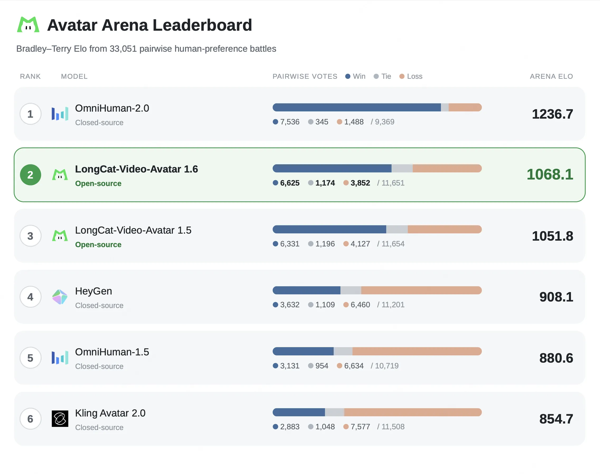

# LongCat-Video-Avatar 1.6

  
  
  
  

    
  

  

## Model Introduction

We are excited to announce the release of LongCat-Video-Avatar 1.6, the latest upgrade to our open-source framework for audio-driven human video generation. Building upon LongCat-Video-Avatar 1.5, 1.6 improves expressive naturalness, lip–audio synchronization, coordinated facial and body motion, and visual consistency during long-form generation. It also introduces comprehensive inference optimizations for faster and more efficient deployment.

**Key Features:**

- 🌟 **More Natural and Stable Lip Animation:**: Reduces exaggerated or strained mouth movements, overly red lip coloration, and temporal instability in the mouth region.
- 🌟 **Stable Long-Video Generation**: Mitigates error accumulation during autoregressive video continuation, enabling videos exceeding 10 minutes while preserving visual quality, identity consistency, and temporal coherence.
- 🌟 **Faster End-to-End Inference**: Accelerates video generation through end-to-end pipeline and model execution optimizations, enabling more efficient deployment and serving.

## 📊 Human Evaluation
We compare LongCat-Video-Avatar 1.6  with its predecessor LongCat-Video-Avatar 1.5  and four commercial systems: OmniHuman-2.0, HeyGen, OmniHuman-1.5, and Kling Avatar 2.0. The all-pairs human preference study comprises 33,051 valid individual votes across all 15 model pairings. LongCat-Video-Avatar 1.6 ranks second among six evaluated systems in a human preference Arena comprising 33,051 valid individual votes. With a Bradley–Terry Elo score of 1068.1, it ranks behind OmniHuman-2.0 and ahead of LongCat-Video-Avatar 1.5, HeyGen, OmniHuman-1.5, and Kling Avatar 2.0.

  

